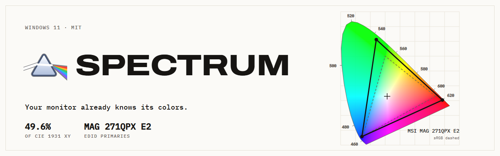
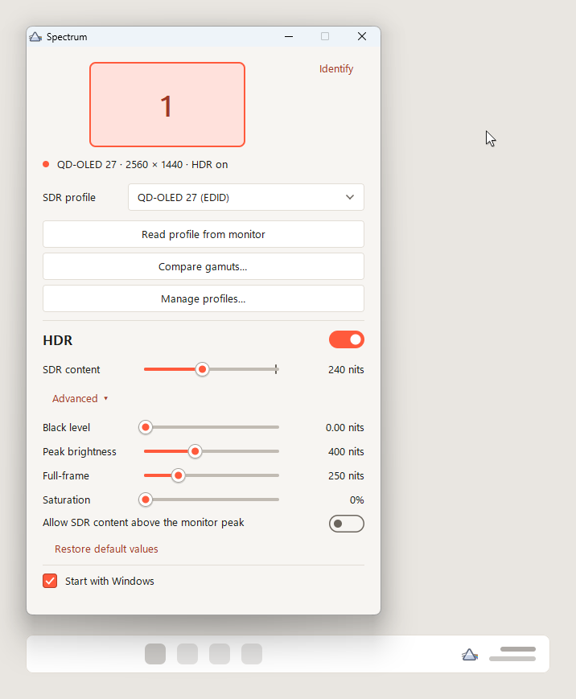
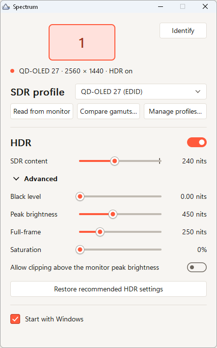
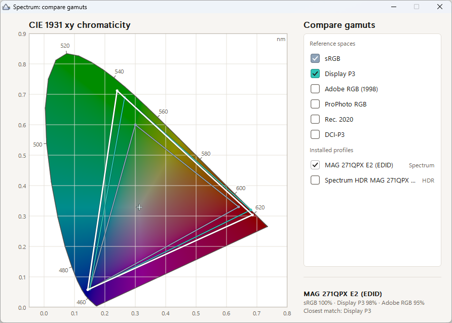
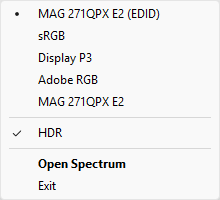
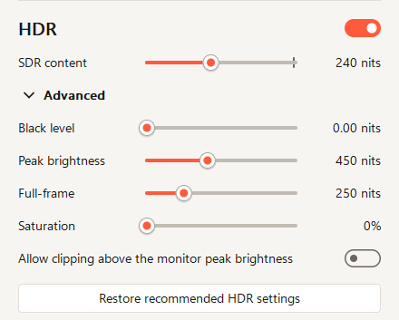

<p align="center">
  <picture>
    <source media="(prefers-color-scheme: dark)" srcset="docs/banner-dark.png">
    
  </picture>
</p>

<p align="center">
  Spectrum is a Windows tray utility that builds ICC profiles from your monitor's EDID and keeps them applied, for SDR and HDR.
</p>

<p align="center">
  <a href="https://github.com/AndreaTorti-01/Spectrum/actions/workflows/ci.yml"></a>
  <a href="https://github.com/AndreaTorti-01/Spectrum/releases/latest"></a>
  <a href="LICENSE"></a>
</p>

<p align="center">
  <b><a href="https://github.com/AndreaTorti-01/Spectrum/releases/latest">Download SpectrumSetup.exe</a></b> from the latest release. It installs per user with no admin prompt. A portable <code>Spectrum.exe</code> is there too.
</p>

<p align="center">
  Windows 11 · 768 KB exe · 1.6 MB idle RAM · MIT
</p>

<p align="center">
  <picture>
    <source media="(prefers-color-scheme: dark)" srcset="docs/demo-dark.webp">
    
  </picture>
</p>

<table>
  <tr>
    <td width="50%" align="center" valign="middle">
      <picture>
        <source media="(prefers-color-scheme: dark)" srcset="docs/screenshots/main-dark-1x.png">
        
      </picture>
      <br>Identify numbers each real screen for 2.5 seconds.
    </td>
    <td width="50%" align="center" valign="middle">
      <picture>
        <source media="(prefers-color-scheme: dark)" srcset="docs/screenshots/gamut-dark-1x.png">
        
      </picture>
      <br>Reference gamuts plus every matrix profile you have installed.
    </td>
  </tr>
  <tr>
    <td width="50%" align="center" valign="middle">
      <picture>
        <source media="(prefers-color-scheme: dark)" srcset="docs/screenshots/traymenu-dark-1x.png">
        
      </picture>
      <br>Left-click the tray icon to toggle the main window.
    </td>
    <td width="50%" align="center" valign="middle">
      <picture>
        <source media="(prefers-color-scheme: dark)" srcset="docs/screenshots/hdr-dark-1x.png">
        
      </picture>
      <br>Four sliders write an MHC2 profile on release.
    </td>
  </tr>
</table>

## How it works

### EDID to ICC

Every monitor sends an [EDID](https://en.wikipedia.org/wiki/Extended_Display_Identification_Data) over the cable. Bytes 0x19–0x22 hold the red, green, blue and white chromaticities as 10-bit values, and byte 0x17 holds the gamma. Read profile from monitor decodes them and writes an ICC v4 profile. ArgyllCMS and DisplayCAL aren't needed.

### HDR profiles

The profile copies the layout of the Windows HDR Calibration app: minimum and peak luminance, a saturation matrix that pushes BT.709 toward BT.2020, and identity LUTs. Spectrum alternates two file names so Windows reloads it.

### Driver updates

Spectrum keys each monitor by its EDID and keeps a copy of every profile it generates in `%APPDATA%\Spectrum\profiles`. At startup, on display changes and after sleep, it restores any profile a driver update dropped.

### No admin needed

Standard users can create files in the Windows color folder, and the profile association APIs have a per-user scope. Spectrum uses both. `SpectrumSetup.exe` installs to `%LOCALAPPDATA%\Programs\Spectrum` and offers a Start with Windows option, which adds a Startup-folder shortcut.

## FAQ

<details>
<summary>Does it change anything without asking?</summary>

No. It writes only what you pick. If you change the default profile in Windows Settings, Spectrum follows your change.

</details>

<details>
<summary>Does it use the network?</summary>

No. It makes no network connections and sends no telemetry.

</details>

<details>
<summary>How do I uninstall?</summary>

Use Settings › Apps. Uninstalling removes every profile and association Spectrum created, plus its data folder. For the portable exe, run `Spectrum.exe --cleanup`, then delete the file.

</details>

## Build from source

Spectrum is Rust against the Win32 API (`windows-sys` only), with a GDI-drawn UI. The GNU toolchain brings its own linker, so Visual Studio is not needed.

```
rustup default stable-x86_64-pc-windows-gnu
cargo build --release
```

The installer needs [Inno Setup 6](https://jrsoftware.org/isinfo.php). It writes `target\installer\SpectrumSetup.exe`:

```
iscc /DExePath=..\target\release\Spectrum.exe installer\spectrum.iss
```

The website lives in `site/` and needs Node 22 or newer:

```
cd site
npm ci
npm run dev
```

The site is published by hand: Actions tab → Pages workflow → Run workflow. Set Settings → Pages → Source to GitHub Actions once, before the first run. `scripts/capture.ps1` retakes the screenshots.

## Contributing

Bug reports and pull requests are welcome. Read [CONTRIBUTING.md](CONTRIBUTING.md) first.

## License

[MIT](LICENSE)
